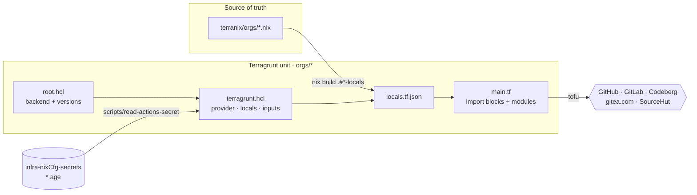
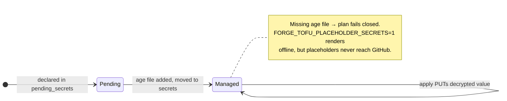
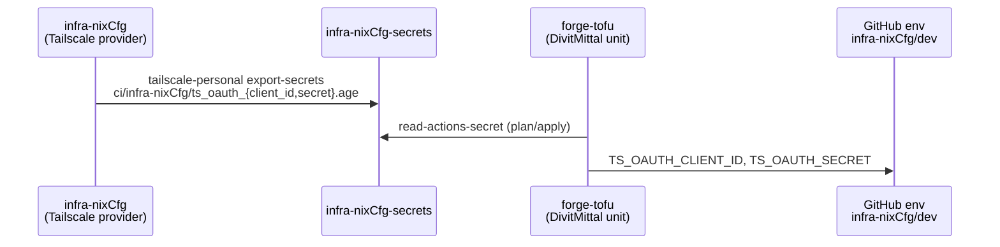

<h1 align='center'>forge-tofu</h1>

<div align='center'>
    <a href='https://opentofu.org/'></a>
    <a href='https://terragrunt.gruntwork.io/'></a>
    <a href='https://terranix.org/'></a>
    <br>
    <a href="https://github.com/DivitMittal/forge-tofu/actions/workflows/flake-check.yml"></a>
    <a href="https://github.com/DivitMittal/forge-tofu/actions/workflows/flake-lock-update.yml"></a>
</div>

---

Declarative management of `DivitMittal`'s repositories across **GitHub, GitLab, Codeberg, gitea.com and SourceHut** with OpenTofu and Terragrunt. Repo maps are written in Nix and compiled to OpenTofu JSON by [Terranix](https://terranix.org/). Secrets come from age files at plan time. The GitHub unit also manages Actions environments and keeps its state encrypted.

> Qezta's repositories moved to [Qezta/infra](https://github.com/Qezta/infra).

## How it fits together



| Unit                    | Provider              | Modules                                                                 | Token override env          |
| ----------------------- | --------------------- | ----------------------------------------------------------------------- | --------------------------- |
| `DivitMittal`           | `integrations/github` | `repositories`, `actions-environments`                                  | `GITHUB_TOKEN_DIVITMITTAL`  |
| `DivitMittal-GitLab`    | `gitlabhq/gitlab`     | `repositories-gitlab`, `branch-protection-gitlab`                       | `GITLAB_TOKEN_DIVITMITTAL`  |
| `DivitMittal-Codeberg`  | `go-gitea/gitea`      | `repositories-gitea`, `branch-protection-gitea`                         | `CODEBERG_TOKEN_DIVITMITTAL`|
| `DivitMittal-Gitea`     | `go-gitea/gitea`      | `repositories-gitea`, `branch-protection-gitea` (`base_url` gitea.com)  | `GITEA_TOKEN_DIVITMITTAL`   |
| `DivitMittal-Sourcehut` | `wombelix/sourcehut`  | `repositories-sourcehut` (SourceHut has no branch protection)           | `SOURCEHUT_TOKEN_DIVITMITTAL`|

The GitHub token falls back to `GITHUB_TOKEN`, then to `gh auth token`. Every other token is decrypted from `secrets/forge/tofu/*.age` unless its override variable is set. The non-GitHub units hold empty scaffolds for now, ready to fill in.

### Guarantees

- **Adopt, never recreate.** `for_each` import blocks pull existing repos into state. Only entries marked `existing = false` get created.
- **`prevent_destroy = true`** on every repository resource, on every forge.
- **`check` blocks** require every active repo to have a description. On GitHub they also validate workflow permissions and Actions secret sources.
- **Forks stay unmanaged.** Leave them out of the repo maps.

## Getting started

Requirements:

- [Nix](https://nixos.org/) with flakes enabled.
- A checkout of `infra-nixCfg-secrets` at `../../Cfgs/infra-nixCfg-secrets` and its agenix key at `~/.ssh/agenix/id_ed25519`. Use `FORGE_TOFU_SECRETS_REPO` / `FORGE_TOFU_AGE_IDENTITY` to point elsewhere.

```bash
nix develop               # or: direnv allow
                          # tofu, terragrunt, agenix, gh, glab, tea, hut, nixd, alejandra

cd orgs/DivitMittal       # or orgs/DivitMittal-<Forge>
terragrunt plan
terragrunt apply

terragrunt run --all plan # every unit, from the repo root
nix fmt                   # format Nix + HCL
nix flake check           # pre-commit hooks + state-encryption test
```

Always run `terragrunt`, never `tofu` directly. Terragrunt generates `backend.tf`, `versions.tf`, `provider.tf` and `locals.tf.json`, all git-ignored.

## Adding a repository

Add an entry to `locals.repos` in `terranix/orgs/<Org>[-<Forge>].nix`, then run `terragrunt plan`:

```nix
"my-new-repo" = {
  description = "What this repo is for";
  visibility = "public";          # SourceHut: public | unlisted | private
  topics = ["nix" "example"];     # GitHub, GitLab
  delete_branch_on_merge = true;  # GitHub, GitLab
  existing = false;               # omit for repos that already exist (they get imported)
};
```

Each forge supports a different set of fields:

| Field                                           | GitHub | GitLab | Codeberg / gitea.com | SourceHut |
| ----------------------------------------------- | :----: | :----: | :------------------: | :-------: |
| `description`, `visibility`, `existing`         |   ✓    |   ✓    |          ✓           |     ✓     |
| `topics`, `delete_branch_on_merge`              |   ✓    |   ✓    |                      |           |
| `homepage_url`                                  |   ✓    |        |          ✓           |           |
| `archived`, `has_issues`                        |   ✓    |   ✓    |          ✓           |           |
| `workflow_permissions`, `actions_can_create_prs`|   ✓    |        |                      |           |
| `locals.protected_branches` (`{ branch = … }`)  |        |   ✓    |          ✓           |           |

GitLab `visibility` also accepts `"internal"`. A ready-made `modules/branch-protection` exists for GitHub but the `DivitMittal` unit doesn't use it yet.

To see the compiled JSON: `nix build .#divitmittal-locals --print-out-paths | xargs cat | jq`. Other units have matching packages, e.g. `.#divitmittal-gitlab-locals`.

## GitHub Actions environments

`locals.actions_environments` in `terranix/orgs/DivitMittal.nix` maps `repo → environment → config`. Each secret names a **source key**. `orgs/DivitMittal/terragrunt.hcl` maps that key to an age file in `infra-nixCfg-secrets`:

```nix
"infra-nixCfg".dev = {
  existing = true;                                    # import, don't create (default)
  secrets.TS_OAUTH_SECRET = "infra_nixcfg_ts_oauth_secret";
  pending_secrets.CACHIX_AUTH_TOKEN = "infra_nixcfg_cachix_auth_token";
  variables = {};                                     # plaintext, public values only
  pending_variables = ["DARWIN_CACHE_PUBLIC_KEY"];
  existing_variables = ["CACHE_ARTIFACT_RECIPIENT"];  # imported once declared in `variables`
};
```

```hcl
# orgs/DivitMittal/terragrunt.hcl → locals.actions_secret_sources
infra_nixcfg_ts_oauth_secret = "ci/infra-nixCfg/ts_oauth_secret.age"
```

A secret moves through these states:



- **Values are write-only.** GitHub never returns a secret's value, so the first apply overwrites the live one. Encrypt the current value, or a freshly rotated one, before you apply.
- **Pending entries** are listed by `tofu output actions_environments_pending`. They are never created or deleted.
- **Existing variables.** Creating a variable is a POST, and it fails (409) when the name already exists. List such names in `existing_variables` so they get imported instead.
- **Undeclared secrets and variables** are left alone.

### Tailscale CI credentials

`DivitMittal/infra-nixCfg` owns the tailnet policy and creates the CI OAuth client. This repo only delivers that client's credentials to the `infra-nixCfg` `dev` environment. It never reads tailnet state or admin credentials.



After you rotate the client, re-run `export-secrets`, commit the age files, then plan and apply this unit.

## Encrypted state (GitHub unit)

`orgs/DivitMittal` encrypts its state and saved plans with PBKDF2 + AES-GCM, enforced. The passphrase is decrypted at runtime from `forge/tofu/github-state-passphrase.age`. Keep that file safe: without it the state can't be recovered. `nix flake check` runs `tests/check-state-encryption.py` to confirm encryption is still enforced.

To migrate old plaintext state once, back it up as an age file first, then run with `FORGE_TOFU_ALLOW_PLAINTEXT_STATE_MIGRATION=true`. That allows reading plaintext state while every write stays encrypted. Remove the flag afterwards. The other forge units keep plain local state.

## CI

The workflows are generated from `flake/actions/` by actions-nix. Its `render-actions` pre-commit hook re-renders `.github/workflows/*.yml` on every commit, so don't edit those files by hand.

| Workflow            | Trigger                                                                                                 | Does                                             |
| ------------------- | ------------------------------------------------------------------------------------------------------- | ------------------------------------------------ |
| `flake-check`       | push/PR to `main` touching `flake.nix`, `flake.lock`, `flake/**`, `modules/**`, `orgs/**`; manual       | `nix flake check --all-systems --no-build`       |
| `flake-lock-update` | first Sunday of each month; manual                                                                      | PR from `DeterminateSystems/update-flake-lock`   |
